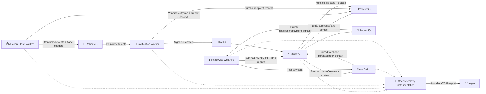

# Cross-stack tracing architecture

Baseline: Part 7 `eb1972c`. Part 8 owns isolated infrastructure and runtime ports. Only a verified signed webhook establishes paid state; diagnostic context and browser signals never do.

Migration 009 adds optional context fields to accepted bids, close outcomes, outbox events, purchases and recipient notifications. Mock session/completion context lives in its existing durable JSON state. W3C trace headers cross HTTP/RabbitMQ boundaries; internal Redis/Socket.IO signals carry a validated trace carrier. Old or malformed context falls back to a fresh trace.

The winning bid anchors close and notification descendants. Independently initiated checkout traces link to the durable close/purchase origin, avoiding spans held open while people wait. Expected rejection/decline has a business outcome without automatic error status. Database wrappers measure operations only under active business spans; empty polls and health checks remain silent. Explicit instrumentation avoids framework, SQL and payload capture. The shared telemetry workspace defines carriers, attributes and bounded Node exporters; the browser exports through a same-origin Vite proxy.

See GOLDEN_TRACE.md for inspection steps and VERIFICATION.md for observed evidence.
